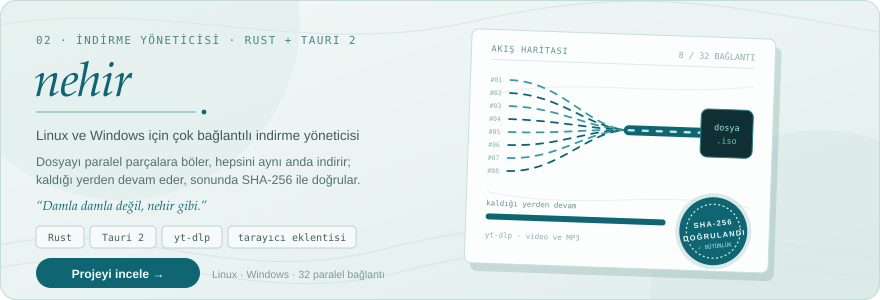
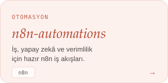
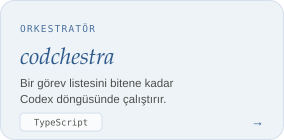
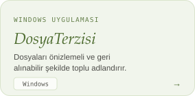

  

  <a href="https://mustafakemal0146.github.io/">mustafakemal0146.github.io</a> ·
  <a href="https://www.linkedin.com/in/mustafakemalcingil/">LinkedIn</a> ·
  <a href="https://www.youtube.com/@mustafakemalcingil">YouTube</a>

#### Son projeler

  <a href="https://github.com/MustafaKemal0146/kandilli-mcp">kandilli-mcp</a> ·
  <a href="https://github.com/MustafaKemal0146/usom-mcp">usom-mcp</a> ·
  <a href="https://github.com/MustafaKemal0146/turkey-power-mcp">turkey-power-mcp</a> ·
  <a href="https://github.com/MustafaKemal0146/trdizin-mcp">trdizin-mcp</a>

#### Diğer çalışmalar

  
  
  

#### Kullandığım teknolojiler

